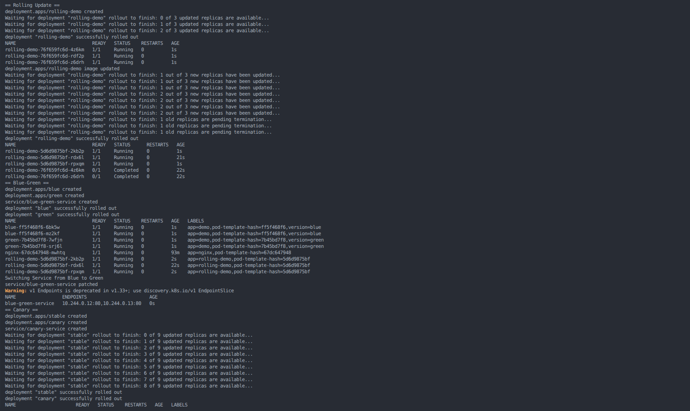

# Session 10: Kubernetes Pods, ReplicaSets & Deployments

## 1. Objective
- Demonstrate Rolling Update, Blue-Green, Canary, and Recreate deployment strategies.
- Inspect Pod lifecycle states using Kubernetes YAML files and `kubectl`.
- Capture command outputs in three screenshots.

## 2. Environment
- OS: Pop!_OS Linux
- Cluster: Minikube
- Runtime: Docker
- CLI: kubectl
- Application: Nginx / BusyBox

## 3. Start and verify Minikube

```bash
sudo systemctl start docker
minikube start --driver=docker
minikube status
kubectl get nodes -o wide
```

## 4. Deployment strategies

### 4.1 Rolling Update
```bash
kubectl apply -f deployments/rolling-update.yaml
kubectl rollout status deployment/rolling-demo
kubectl get pods -l app=rolling-demo
kubectl set image deployment/rolling-demo nginx=nginx:1.28
kubectl rollout status deployment/rolling-demo
kubectl get pods -l app=rolling-demo
```
**Observation:** The Deployment gradually replaces old Pods with new Pods according to its rolling update settings.

### 4.2 Blue-Green
```bash
kubectl apply -f deployments/blue.yaml
kubectl apply -f deployments/green.yaml
kubectl apply -f deployments/blue-green-service.yaml
kubectl get pods --show-labels
kubectl get endpoints blue-green-service
kubectl patch service blue-green-service -p '{"spec":{"selector":{"app":"demo","version":"green"}}}'
kubectl get endpoints blue-green-service
```
**Observation:** The Service selector switches traffic from Blue Pods to Green Pods. Both versions remain deployed.

### 4.3 Canary
```bash
kubectl apply -f deployments/canary.yaml
kubectl rollout status deployment/stable
kubectl rollout status deployment/canary
kubectl get pods -l app=canary-demo --show-labels
kubectl get endpoints canary-service
```
**Observation:** Nine stable replicas and one canary replica are selected by a shared Service. This approximates 10% of endpoints, but does not guarantee exactly 10% of requests; request-level percentages usually require an ingress controller or service mesh.

### 4.4 Recreate
```bash
kubectl apply -f deployments/recreate.yaml
kubectl rollout status deployment/recreate-demo
kubectl get pods -l app=recreate-demo
kubectl set image deployment/recreate-demo nginx=nginx:1.28
kubectl rollout status deployment/recreate-demo
kubectl get pods -l app=recreate-demo
```
**Observation:** The Recreate strategy terminates old Pods before creating replacement Pods, so temporary downtime can occur.

## 5. Pod lifecycle

Apply and inspect each YAML:

```bash
kubectl apply -f pods/pod-running.yaml
kubectl apply -f pods/pod-completed.yaml
kubectl apply -f pods/pod-failing.yaml
sleep 10
kubectl get pods
kubectl describe pod lifecycle-running
kubectl describe pod lifecycle-completed
kubectl describe pod lifecycle-failing
```

**Running Pod:** Nginx should reach `Running`.

**Completed Pod:** The BusyBox command prints a message and exits successfully. With `restartPolicy: Never`, the Pod should reach `Succeeded`.

**Failing Pod:** The container exits with a non-zero status. Kubernetes retries it, typically leading to `CrashLoopBackOff`. This is a container restart condition, not a Pod phase.

Common Pod phases are `Pending`, `Running`, `Succeeded`, `Failed`, and `Unknown`.

## 6. Screenshots

Save your own terminal screenshots in the `screenshots/` directory using these exact filenames.

### Screenshot 1 — Deployment strategies


Capture the output from the Rolling Update, Blue-Green, Canary, and Recreate commands.

### Screenshot 2 — Pod lifecycle status


Capture `kubectl get pods` after the lifecycle Pods have had time to start, complete, or fail.

### Screenshot 3 — Pod details


Capture the relevant output from `kubectl describe pod lifecycle-running`, `kubectl describe pod lifecycle-completed`, and `kubectl describe pod lifecycle-failing`.

## 7. Key learnings
- Pods run containers; ReplicaSets maintain a desired number of Pod replicas.
- Deployments manage ReplicaSets and support rollout strategies.
- Rolling Update replaces Pods gradually.
- Blue-Green switches a Service between two versions.
- Canary introduces a new version alongside a stable version.
- Recreate replaces all old Pods before starting the new version.
- `kubectl get` and `kubectl describe` help inspect status, conditions, and events.

## 8. References
- [Kubernetes Pods](https://kubernetes.io/docs/concepts/workloads/pods/)
- [ReplicaSets](https://kubernetes.io/docs/concepts/workloads/controllers/replicaset/)
- [Deployments](https://kubernetes.io/docs/concepts/workloads/controllers/deployment/)
- [Kubernetes Basics Tutorial](https://kubernetes.io/docs/tutorials/kubernetes-basics/)
