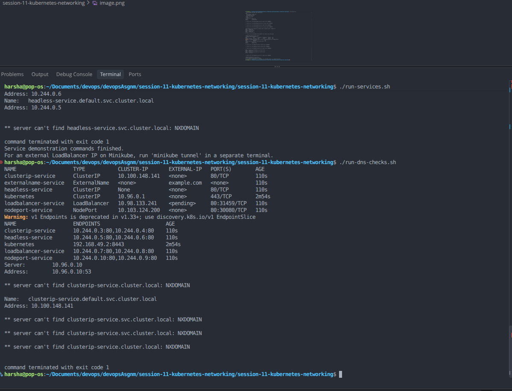
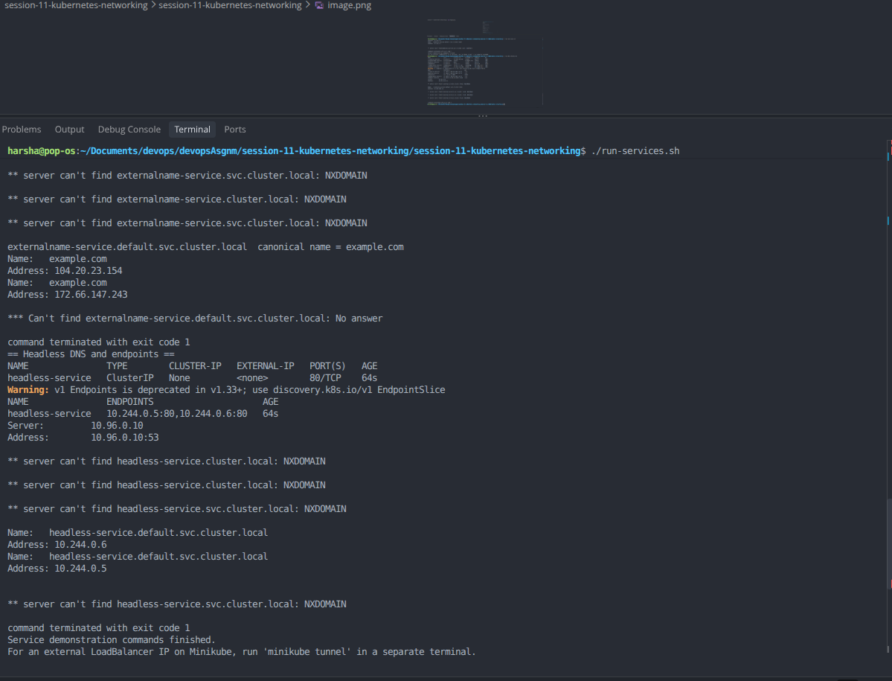

# Session 11: Kubernetes Networking & Services

## 1. Objective
- Deploy and test ClusterIP, NodePort, LoadBalancer, ExternalName, and Headless Services.
- Compare common Kubernetes workload and networking objects.
- Understand Kubernetes FQDN and CoreDNS.

## 2. Environment
- OS: Pop!_OS Linux
- Cluster: Minikube
- Runtime: Docker
- CLI: kubectl

## 3. Start and verify the cluster

```bash
sudo systemctl start docker
minikube start --driver=docker
minikube status
kubectl get nodes -o wide
```

## 4. Kubernetes Services

Apply all Service resources:

```bash
kubectl apply -f services/
kubectl get deployments,pods,services
kubectl get endpoints
```

### 4.1 ClusterIP
ClusterIP exposes an application inside the cluster only. Test it from a temporary Pod:

```bash
kubectl run curl-test --image=curlimages/curl:8.10.1 --restart=Never --command -- sleep 3600
kubectl wait --for=condition=Ready pod/curl-test --timeout=120s
kubectl exec curl-test -- curl -sS http://clusterip-service
```

### 4.2 NodePort
NodePort exposes a Service on a port on each node. On Minikube, use:

```bash
kubectl get service nodeport-service
minikube service nodeport-service --url
```

Open the printed URL or use curl from a terminal where the Minikube URL is reachable.

### 4.3 LoadBalancer
A LoadBalancer Service requests an external load balancer. In local Minikube, its external IP may remain pending until the Minikube tunnel is running.

```bash
kubectl get service loadbalancer-service
minikube tunnel
```

Keep `minikube tunnel` running in a separate terminal; then check the Service again:

```bash
kubectl get service loadbalancer-service
```

If the external IP is assigned, test it with `curl http://EXTERNAL-IP`. Otherwise, test its ClusterIP from `curl-test`:

```bash
kubectl exec curl-test -- curl -sS http://loadbalancer-service
```

### 4.4 ExternalName
ExternalName creates a DNS alias to an external hostname and does not proxy traffic or create Pod endpoints.

```bash
kubectl get service externalname-service
kubectl get service externalname-service -o yaml
kubectl exec curl-test -- nslookup externalname-service
```

DNS resolution depends on the cluster DNS configuration and network access. This example aliases `example.com`.

### 4.5 Headless Service
A headless Service has `clusterIP: None`. DNS returns the backing Pod addresses instead of a single virtual ClusterIP.

```bash
kubectl get service headless-service
kubectl get endpoints headless-service
kubectl exec curl-test -- nslookup headless-service
```

## 5. Screenshots

Capture your real command output and save exactly three screenshots in `screenshots/`.

### Screenshot 1 — Service resources


Capture `kubectl get deployments,pods,services` and `kubectl get endpoints`.

### Screenshot 2 — Connectivity tests


Capture successful ClusterIP and LoadBalancer in-cluster curl tests, NodePort access, and DNS checks. If the LoadBalancer external IP is pending, note that Minikube tunnel is required.

### Screenshot 3 — DNS and FQDN


Capture `nslookup` output for the ExternalName and headless Service and the relevant Service YAML.

## 6. Object comparisons
See the detailed comparison in [Kubernetes Object Comparison](object-comparison.md).

## 7. FQDN
See [FQDN documentation](fqdn/README.md).

## 8. CoreDNS
See [CoreDNS documentation](coredns/README.md).

## 9. References
- [Kubernetes Services](https://kubernetes.io/docs/concepts/services-networking/service/)
- [Kubernetes DNS for Services and Pods](https://kubernetes.io/docs/concepts/services-networking/dns-pod-service/)
- [CoreDNS](https://coredns.io/)
- [Minikube](https://minikube.sigs.k8s.io/docs/)
