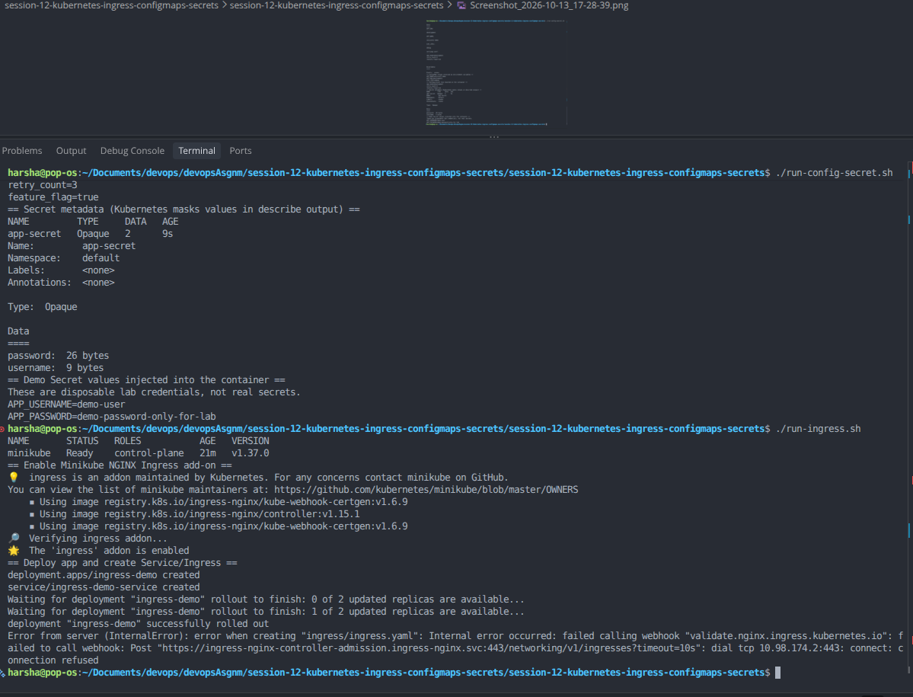
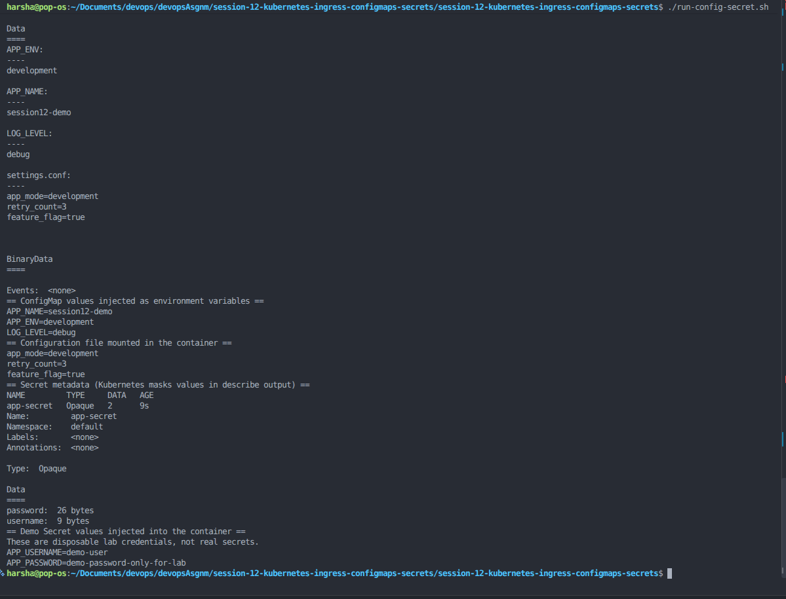
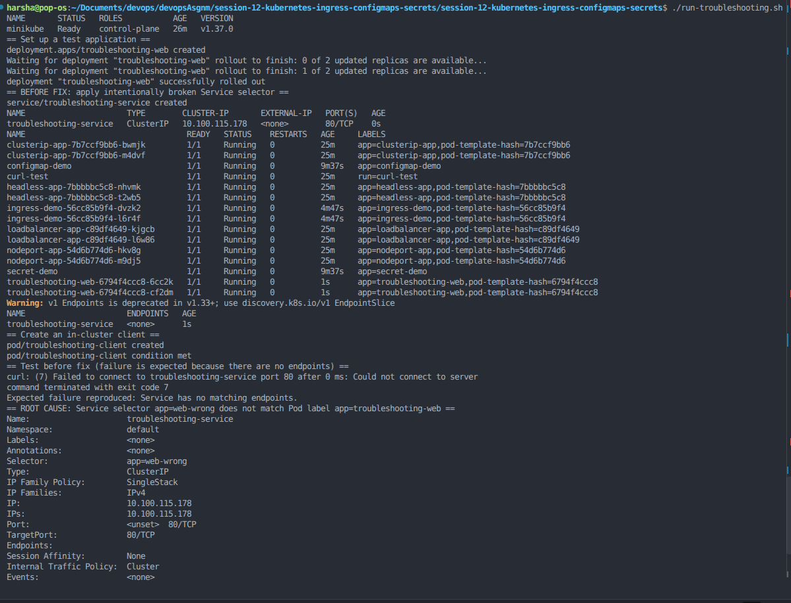

# Session 12: Kubernetes Ingress, ConfigMaps & Secrets

## 1. Objective
- Create a ConfigMap and inject settings into a Pod.
- Create a demo Secret and inject values into a Pod.
- Deploy an application and route traffic through Ingress.
- Explain Ingress vs Ingress Controller.
- Reproduce and fix a Service-selector troubleshooting issue.

## 2. Environment
- OS: Pop!_OS Linux
- Cluster: Minikube
- Runtime: Docker
- CLI: kubectl

## 3. Start and verify Minikube

Run this first if your cluster is stopped or `kubectl` points at `localhost:8080`:

```bash
sudo systemctl start docker
minikube start --driver=docker
minikube update-context
kubectl config use-context minikube
kubectl get nodes
```

## 4. ConfigMap and Secret

Run:

```bash
./run-config-secret.sh
```

The script creates a ConfigMap and a demo-only Secret, injects them into Pods, and prints the injected values and mounted configuration file.

### ConfigMap
A ConfigMap stores non-sensitive configuration, such as an app mode or log level. It is injected as environment variables and as a mounted file in this demo.

### Secret
A Kubernetes Secret stores sensitive values and can be exposed to a Pod as environment variables or mounted files. The included credential is a disposable lab example only. Do not use real passwords or tokens in this repository. Base64 in a Secret manifest is encoding, not encryption. In production, restrict RBAC access and configure encryption at rest or use an appropriate external secrets manager.



## 5. Ingress

Run:

```bash
./run-ingress.sh
```

The script enables Minikube's NGINX Ingress add-on, deploys Nginx, creates a Service and Ingress rule, then uses port-forwarding to test host-based routing with `Host: session12.local`.

### What is Ingress?
Ingress is a Kubernetes API resource containing HTTP/HTTPS routing rules, such as routing requests for `session12.local/` to a Service.

### What is an Ingress Controller?
An Ingress Controller is the running implementation that watches Ingress resources and configures a proxy/load balancer to implement their routing rules. In this lab, Minikube's NGINX Ingress add-on supplies the controller.

### Ingress vs Ingress Controller

| Ingress | Ingress Controller |
|---|---|
| Declarative API resource containing routing rules | Running software that implements those rules |
| Specifies host/path and backend Service | Watches Ingress resources and configures request routing |
| Does not route traffic by itself | Handles incoming traffic according to supported rules |
| Example: `ingress/demo-ingress.yaml` | Example: Minikube NGINX Ingress controller |

Both are required: the Ingress defines the desired routing, and the controller makes it work. An Ingress resource without a functioning controller usually does not route traffic.



## 6. Troubleshooting

Run:

```bash
./run-troubleshooting.sh
```

The script deliberately creates a Service whose selector does not match the Deployment's Pod labels. It shows the missing endpoints and a failed in-cluster request, then applies a corrected Service and verifies that endpoints and connectivity work.

**Root cause:** the Service selector was `app: web-wrong`, but the Pods have label `app: troubleshooting-web`.

**Fix:** change the Service selector to `app: troubleshooting-web`.



## 7. Screenshots

The screenshots above show the real terminal output for the ConfigMap and Secret, Ingress, and Service-selector troubleshooting exercises.

## 8. Cleanup (optional)

```bash
kubectl delete -f configmaps/
kubectl delete -f secrets/
kubectl delete -f ingress/
kubectl delete -f troubleshooting/service-fixed.yaml --ignore-not-found
kubectl delete -f troubleshooting/service-broken.yaml --ignore-not-found
kubectl delete -f troubleshooting/deployment.yaml --ignore-not-found
kubectl delete pod troubleshooting-client --ignore-not-found
```

The Ingress controller add-on is cluster-level; disable it only if you no longer need it:

```bash
minikube addons disable ingress
```

## 9. References
- [ConfigMaps](https://kubernetes.io/docs/concepts/configuration/configmap/)
- [Secrets](https://kubernetes.io/docs/concepts/configuration/secret/)
- [Ingress](https://kubernetes.io/docs/concepts/services-networking/ingress/)
- [Minikube Ingress](https://minikube.sigs.k8s.io/docs/handbook/addons/ingress/)
