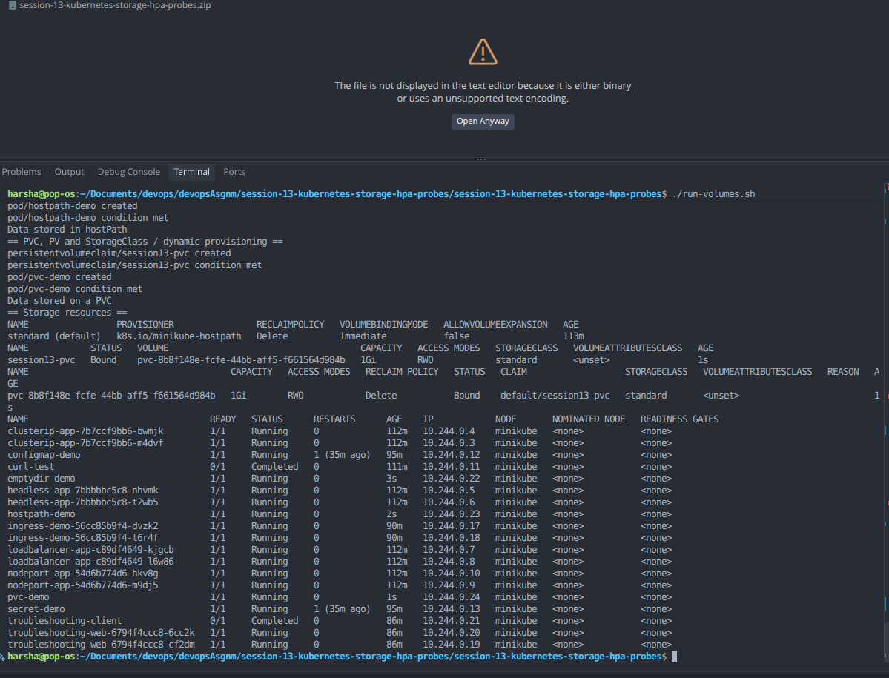
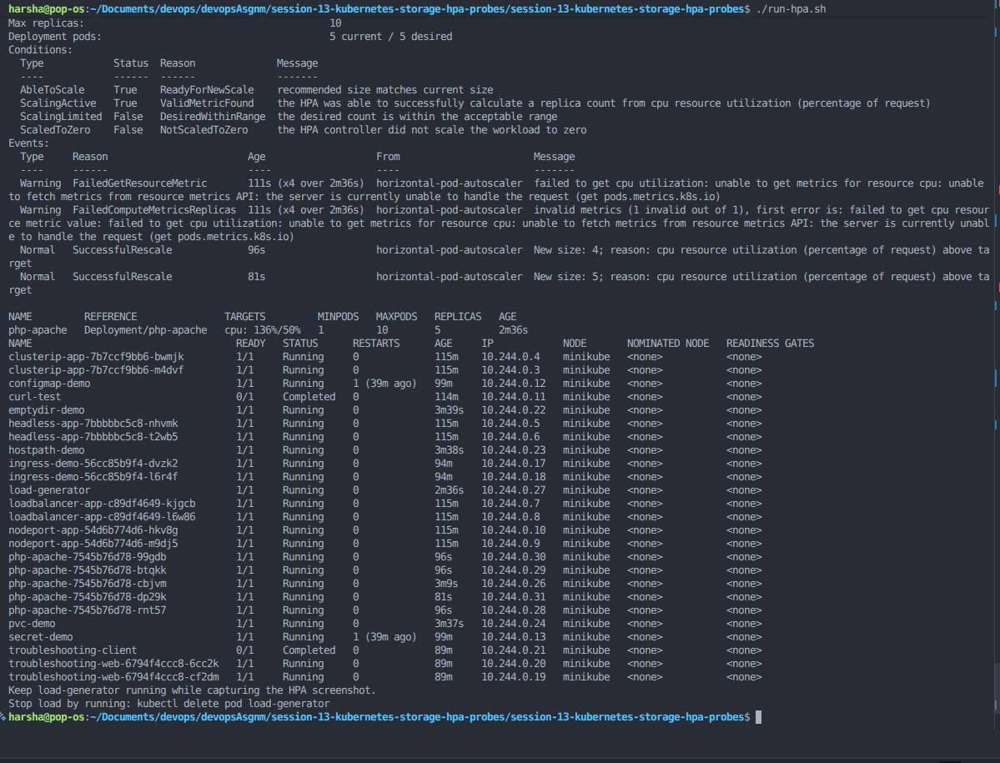
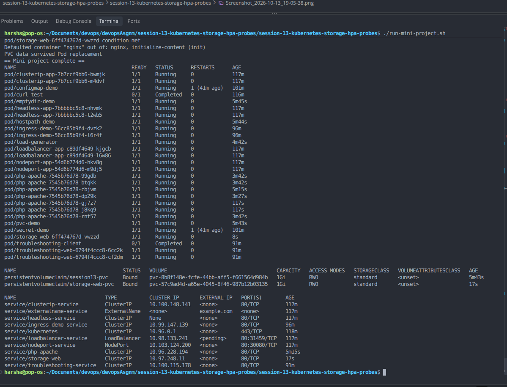

# Session 13: Kubernetes Storage, HPA & Probes

## 1. Objective
- Explore `emptyDir`, `hostPath`, PersistentVolumes, PersistentVolumeClaims, StorageClasses, and dynamic provisioning.
- Deploy an application and configure a Horizontal Pod Autoscaler (HPA).
- Generate load and observe CPU utilization and Pod scaling.
- Complete a small persistent web application project with health probes.
- Capture three screenshots of real command output.

## 2. Environment
- OS: Pop!_OS Linux
- Cluster: Minikube
- Runtime: Docker
- CLI: kubectl

## 3. Start and verify Minikube

```bash
sudo systemctl start docker
minikube start --driver=docker
minikube update-context
kubectl config use-context minikube
kubectl get nodes
```

## 4. Kubernetes Volumes

The detailed storage notes are in [`01-kubernetes-volumes/README.md`](01-kubernetes-volumes/README.md).

Run the hands-on volume demonstrations:

```bash
./run-volumes.sh
```

The script demonstrates emptyDir, hostPath, a PersistentVolumeClaim, and the default StorageClass / dynamic provisioning.

## 5. HPA Hands-on

Run:

```bash
./run-hpa.sh
```

The script enables Minikube metrics-server, deploys the CPU-consuming sample application, applies `hpa/hpa.yml`, starts a load generator, and repeatedly displays HPA status, Pod count, and CPU metrics.

Useful commands:

```bash
kubectl get hpa
kubectl get pods
kubectl top pods
kubectl describe hpa php-apache
```

The autoscaler needs metrics-server and time to collect metrics. CPU requests are defined on the application container because HPA CPU utilization is calculated relative to requested CPU. Scaling may take a minute or more.

## 6. Mini Project: Persistent Web Page with Health Probes

Run:

```bash
./run-mini-project.sh
```

The project uses:
- A ConfigMap containing the initial web page.
- A dynamically provisioned PVC to persist website files.
- An Nginx Deployment with readiness and liveness HTTP probes.
- A ClusterIP Service.
- A Pod-replacement test that verifies a file remains on the PVC.

The script uses a local port-forward to test the page and checks persistence after replacing the Pod.

## 7. Screenshots

Capture three real terminal screenshots and save them using these filenames:

### Screenshot 1 — Storage / volumes



Capture volume resources and verification commands from `./run-volumes.sh`.

### Screenshot 2 — HPA scaling



Capture `kubectl get hpa`, `kubectl get pods`, `kubectl top pods`, and `kubectl describe hpa php-apache` while the load generator is running.

### Screenshot 3 — Mini project / probes / persistence



Capture readiness/liveness probe details, the successful HTTP response, and the persistent file check after Pod replacement.

## 8. Cleanup (optional)

```bash
kubectl delete pod load-generator --ignore-not-found
kubectl delete -f hpa/hpa.yml --ignore-not-found
kubectl delete -f hpa/app.yaml --ignore-not-found
kubectl delete -f mini-project/ --ignore-not-found
kubectl delete pod emptydir-demo hostpath-demo pvc-demo --ignore-not-found
kubectl delete -f 01-kubernetes-volumes/pvc.yaml --ignore-not-found
kubectl delete -f 01-kubernetes-volumes/emptydir-pod.yaml --ignore-not-found
kubectl delete -f 01-kubernetes-volumes/hostpath-pod.yaml --ignore-not-found
minikube addons disable metrics-server
```

Deleting a PVC can delete its dynamically provisioned storage depending on the StorageClass reclaim policy. Only run cleanup after screenshots are saved.

## 9. References
- [Kubernetes Volumes](https://kubernetes.io/docs/concepts/storage/volumes/)
- [Persistent Volumes and Claims](https://kubernetes.io/docs/concepts/storage/persistent-volumes/)
- [Storage Classes](https://kubernetes.io/docs/concepts/storage/storage-classes/)
- [Horizontal Pod Autoscaling](https://kubernetes.io/docs/tasks/run-application/horizontal-pod-autoscale/)
- [Liveness, Readiness and Startup Probes](https://kubernetes.io/docs/concepts/configuration/liveness-readiness-startup-probes/)
