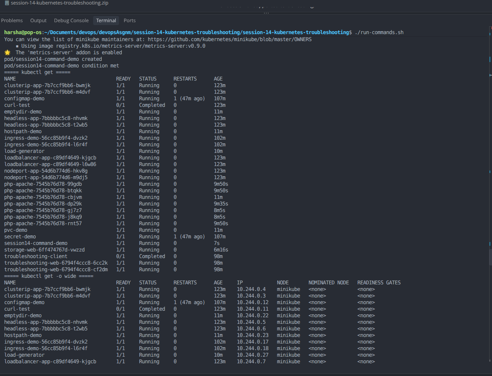
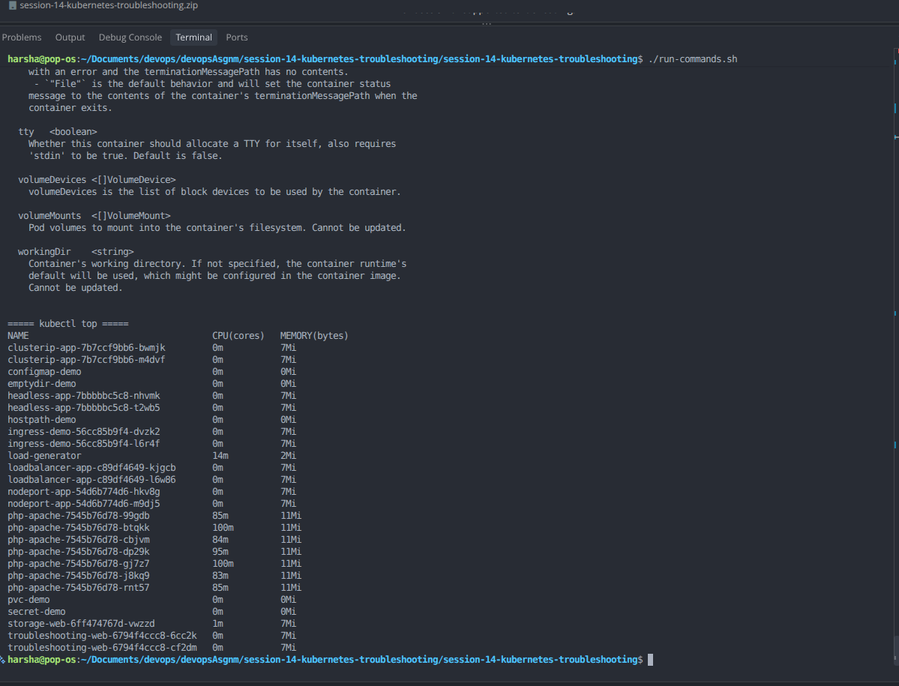

# Session 14: Kubernetes Troubleshooting

## 1. Objectives
- Practice `kubectl get`, `describe`, `logs`, `exec`, `events`, `explain`, `top`, and `get -o wide`.
- Diagnose and fix CrashLoopBackOff, ErrImagePull/ImagePullBackOff, Pending, ContainerCreating/mount, Service, DNS, Pod-port, and ConfigMap issues.
- Complete a mini project with Nginx, a ConfigMap, a Service, and health probes.

## 2. Start Minikube

```bash
sudo systemctl start docker
minikube start --driver=docker
minikube update-context
kubectl config use-context minikube
kubectl get nodes
```

If `kubectl` tries `localhost:8080`, refresh the Minikube context as shown above.

## 3. Task 1 — Kubernetes troubleshooting commands

Run:

```bash
./run-commands.sh
```

It demonstrates:

```bash
kubectl get pods
kubectl get pods -o wide
kubectl describe pod session14-command-demo
kubectl logs session14-command-demo
kubectl exec session14-command-demo -- sh -c 'echo hello from inside the container'
kubectl events --for pod/session14-command-demo
kubectl explain pod.spec.containers
kubectl top pods
```

The script enables Minikube metrics-server for `kubectl top`.

## 4. Task 2 — Common issues and fixes

Run:

```bash
./run-troubleshooting.sh
```

| Problem | Root cause | Solution |
|---|---|---|
| CrashLoopBackOff | Container command exits with status 1 | Replace failing command |
| ErrImagePull / ImagePullBackOff | Image tag does not exist | Use `nginx:1.27` |
| Pending | Node selector requires a nonexistent node label | Remove the impossible selector |
| ContainerCreating / FailedMount | Pod references a missing ConfigMap volume | Create ConfigMap and correct its name |
| Service connectivity | Service selector matches no Pods | Match selector to Pod labels |
| DNS | Service name is misspelled | Query the correct Service FQDN |
| Pod/network port issue | `targetPort` is 8081 but Nginx listens on 80 | Set `targetPort: 80` |
| Configuration issue | Pod references a missing ConfigMap | Create and reference the correct ConfigMap |

For each case, the script shows the broken resource, runs investigation commands, applies the fix, and verifies the corrected state.

**Note:** `ContainerCreating` is a transient container state, not a Pod phase. The missing ConfigMap mount may appear as `Pending`, `ContainerCreating`, or a `FailedMount` event depending on timing/version. Inspect `kubectl describe pod` and Events.

General investigation commands:

```bash
kubectl get pods -o wide
kubectl describe pod POD_NAME
kubectl logs POD_NAME
kubectl logs POD_NAME --previous
kubectl get events --sort-by=.lastTimestamp
kubectl get services,endpoints
kubectl describe service SERVICE_NAME
kubectl exec network-client -- nslookup SERVICE_FQDN
kubectl top pods
```

## 5. Task 3 — Mini project

Run:

```bash
./run-mini-project.sh
```

This deploys a ConfigMap-backed Nginx page, a ClusterIP Service, and readiness/liveness HTTP probes. The script verifies the Service using local port-forwarding and displays application logs.

Manifests are in `mini-project/`.

## 6. Screenshots

The available screenshots show the command demonstration output:

### Screenshot 1 — kubectl commands



These are sequential captures of the `get`, `get -o wide`, `describe`, `logs`, `exec`, `events`, `explain`, and `top` commands.

## 7. Cleanup (optional, after screenshots)

```bash
kubectl delete -f commands/ --ignore-not-found
kubectl delete -f troubleshooting/ --ignore-not-found
kubectl delete -f mini-project/ --ignore-not-found
kubectl delete pod network-client --ignore-not-found
```

## 8. References
- [kubectl reference](https://kubernetes.io/docs/reference/kubectl/)
- [Debugging Pods](https://kubernetes.io/docs/tasks/debug/debug-application/debug-pods/)
- [Debugging Services](https://kubernetes.io/docs/tasks/debug/debug-application/debug-service/)
- [Debugging DNS](https://kubernetes.io/docs/tasks/administer-cluster/dns-debugging-resolution/)
- [Liveness, Readiness and Startup Probes](https://kubernetes.io/docs/concepts/configuration/liveness-readiness-startup-probes/)
