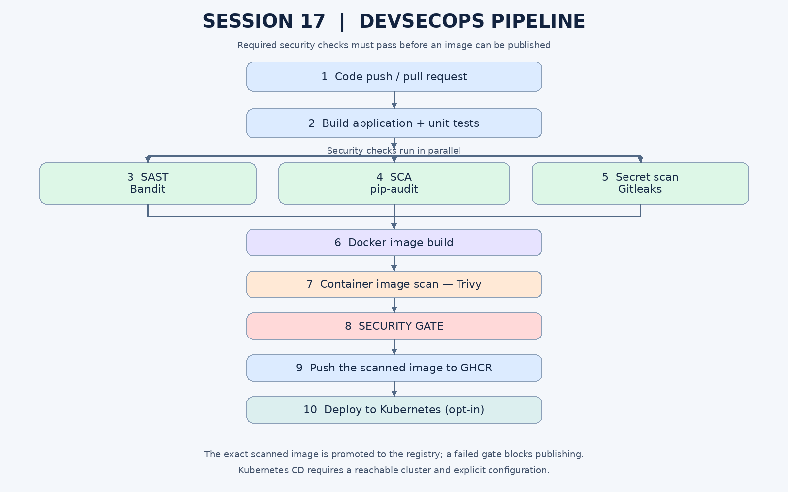

# Session 17: Complete CI/CD & DevSecOps Pipeline

## 1. Objective

Build a small application and automate its build, tests, security checks, container image creation, registry publishing, and Kubernetes deployment with GitHub Actions.

## 2. DevSecOps pipeline

The following diagram shows the pipeline designed in this repository. It is an architecture diagram, not a screenshot of an already-executed GitHub Actions run.



Expected workflow:

```text
Code → Build → Unit Tests → SAST → SCA → Secret Scan
     → Docker Build → Container Image Scan → Security Gate
     → Push Image to GHCR → Deploy to Kubernetes (when enabled)
```

## 3. Project structure

```text
session-17-devsecops/
├── app/
│   └── app.py
├── tests/
│   └── test_app.py
├── requirements.txt
├── requirements-dev.txt
├── Dockerfile
├── .dockerignore
├── .gitleaks.toml
├── .github/workflows/devsecops.yml
├── k8s/
│   ├── deployment.yaml
│   └── service.yaml
├── scripts/
│   └── deploy-local-minikube.sh
├── docs/
│   └── devsecops-pipeline.png
└── screenshots/
    └── (add your actual GitHub Actions screenshots here)
```

## 4. Technologies and security tools

| Stage | Tool | Purpose |
|---|---|---|
| Application | Python + Flask | Small HTTP service with a health endpoint |
| Build and test | pip + pytest | Install dependencies and run unit tests |
| SAST | Bandit | Find common security problems in Python source |
| SCA | pip-audit | Check Python dependencies for published vulnerabilities |
| Secret scanning | Gitleaks | Detect accidentally committed credentials or tokens |
| Container image scan | Trivy | Scan the built image for OS/library vulnerabilities |
| Image registry | GitHub Container Registry (GHCR) | Store the validated container image |
| Deployment | Kubernetes + kubectl | Deploy the image to a cluster |
| CI/CD automation | GitHub Actions | Orchestrate jobs and enforce job dependencies |

## 5. CI vs CD

**Continuous Integration (CI)** automatically builds and tests changes on pushes and pull requests. It runs source and dependency security checks before an image can pass the gate.

**Continuous Delivery/Deployment (CD)** publishes the validated image to GHCR and can deploy it to Kubernetes. In this project, automatic Kubernetes deployment is opt-in because GitHub-hosted runners cannot normally reach a developer's local Minikube cluster.

## 6. Security gates

The workflow runs the following checks:

1. **Unit tests:** pytest must pass.
2. **SAST:** Bandit scans the Python application.
3. **SCA:** pip-audit checks application requirements against vulnerability advisories.
4. **Secret scanning:** Gitleaks scans the Git history and working tree.
5. **Container scan:** Trivy checks the built image for fixable HIGH and CRITICAL vulnerabilities.
6. **Security gate:** publishing is allowed only if the build/tests and all configured scanners succeed.

The Trivy gate uses `ignore-unfixed: true` and fails on fixable HIGH/CRITICAL findings. A gate failure is expected when a real finding exists; update the base image or dependency and rerun rather than silently disabling the gate. Security scanners can change their findings as vulnerability databases are updated.

## 7. Run locally

Create a virtual environment and run the tests:

```bash
python3 -m venv .venv
source .venv/bin/activate
pip install -r requirements.txt -r requirements-dev.txt
pytest -q
python -m flask --app app.app run --host 127.0.0.1 --port 5000
```

In another terminal:

```bash
curl http://127.0.0.1:5000/
curl http://127.0.0.1:5000/healthz
curl http://127.0.0.1:5000/api/version
```

## 8. Build and run Docker image

```bash
docker build -t devsecops-demo:local .
docker run --rm -p 5000:5000 devsecops-demo:local
```

Then test `http://127.0.0.1:5000/healthz`.

## 9. GitHub Actions workflow

The workflow is located at `.github/workflows/devsecops.yml` and runs on pushes to `main`, pull requests targeting `main`, and manual dispatch.

The first jobs build/test and scan source code, dependencies, and Git history in parallel. Once those checks pass, the container image is built and scanned. The successfully scanned image is saved as a workflow artifact and promoted to GHCR without rebuilding it, preventing a different image from being published after scanning. A security-gate job checks every required result. Only a successful gate allows publishing to GHCR on a push to `main`.

### Publish to GHCR

The publish job uses GitHub's automatically provided `GITHUB_TOKEN`; no Docker Hub token is required. Workflow permissions are limited to `contents: read` and `packages: write` for the publishing job.

### Kubernetes deployment (optional)

The deploy job runs only when a repository Actions variable named `DEPLOY_TO_K8S` is set to `true` and the workflow runs on `main`. Configure a repository Actions secret named `KUBE_CONFIG_B64` containing the base64-encoded kubeconfig for a **reachable test cluster**.

Generate the encoded value on your own machine:

```bash
base64 -w 0 ~/.kube/config
```

Copy the output into GitHub → **Settings → Secrets and variables → Actions → New repository secret** as `KUBE_CONFIG_B64`. Do not commit the kubeconfig or its decoded contents. GitHub-hosted runners need network access to the cluster API endpoint. A local Minikube endpoint on your laptop is not normally reachable from GitHub-hosted runners; use the local deployment script below or a suitably configured self-hosted runner.

The deployed image is published to GHCR. For a simple class demo, make the resulting GHCR package public after first publication, or configure Kubernetes image-pull credentials for a private package.

## 10. Deploy locally to Minikube

This works without exposing your local cluster to GitHub:

```bash
sudo systemctl start docker
minikube start --driver=docker
minikube update-context
kubectl config use-context minikube
./scripts/deploy-local-minikube.sh
```

The script builds the local image, loads it into Minikube, substitutes the image in the Deployment manifest, applies the Kubernetes resources, waits for rollout, and port-forwards the Service to `http://127.0.0.1:18086`.

## 11. Security configuration notes

- **SAST:** `bandit -r app -ll` is configured to fail on medium/high severity findings.
- **SCA:** `pip-audit` is configured as a blocking check.
- **Secret scanning:** Gitleaks runs as a blocking check. For personal accounts, the Gitleaks Action does not require a license; organization repositories may require a Gitleaks license secret.
- **Container scanning:** Trivy reports image vulnerabilities and fails the stage on fixable HIGH/CRITICAL findings.
- **Least privilege:** job permissions are scoped instead of granting all permissions globally.
- **Container hardening:** the Docker image runs as a non-root user; Kubernetes sets security context, resource requests/limits, and health probes.
- **Secrets:** do not store credentials in the repository. Rotate any credential that has been exposed, even if later removed from a file.

## 12. Screenshots

Add your own screenshots from the actual GitHub Actions run. The pipeline diagram above is documentation, not proof of a successful run.

### Screenshot 1 — CI build and unit tests

<!-- Add your actual screenshot here, for example:

-->

### Screenshot 2 — Security scans and security gate

<!-- Add your actual screenshot here, for example:

-->

### Screenshot 3 — Image publish and Kubernetes deployment

<!-- Add your actual screenshot here, for example:

-->

## 13. References

- [GitHub Actions](https://docs.github.com/en/actions)
- [Publishing to GitHub Container Registry](https://docs.github.com/en/packages/working-with-a-github-packages-registry/working-with-the-container-registry)
- [Bandit](https://bandit.readthedocs.io/)
- [pip-audit](https://github.com/pypa/pip-audit)
- [Gitleaks Action](https://github.com/gitleaks/gitleaks-action)
- [Trivy Action](https://github.com/aquasecurity/trivy-action)
- [Kubernetes Deployments](https://kubernetes.io/docs/concepts/workloads/controllers/deployment/)
