# Session 18: Terraform & Infrastructure as Code

## Overview

This assignment has two parts:

1. **Terraform S3 demo** — create and manage a private S3 bucket using Terraform.
2. **AWS services research** — concise reference notes for IAM, EC2, S3, VPC, DynamoDB, and RDS.

## Project structure

```text
session-18-terraform-iac/
├── terraform-s3-demo/
│   ├── main.tf
│   ├── variables.tf
│   ├── outputs.tf
│   ├── provider.tf
│   ├── terraform.tfvars
│   ├── .gitignore
│   └── README.md
└── aws-services/
    ├── 01-iam/README.md
    ├── 02-ec2/README.md
    ├── 03-s3/README.md
    ├── 04-vpc/README.md
    └── 05-dynamodb-rds/README.md
```

## Prerequisites

- An AWS account where you are permitted to create S3 resources.
- Terraform CLI and AWS CLI installed.
- AWS credentials configured through an approved method, such as AWS CLI profiles, IAM Identity Center, or environment credentials.
- A region supported by your account. The example uses `ap-south-1` (Mumbai); change it in `terraform.tfvars` if needed.

Check your configuration before applying:

```bash
terraform -version
aws --version
aws sts get-caller-identity
```

**Security and cost:** The Terraform demo creates a real AWS S3 bucket. It is configured with public access blocked, default encryption, and versioning. S3 usage may incur charges depending on usage and account pricing. Do not commit AWS credentials, access keys, Terraform state, or state backups to Git. Review the plan before applying and run `terraform destroy` when finished.

## Task 1 — Terraform S3 demo

See [`terraform-s3-demo/README.md`](terraform-s3-demo/README.md) for the complete command-by-command workflow:

`terraform init → fmt → validate → plan → apply → show → output → destroy`

### Terraform workflow screenshots

The following screenshots show the Terraform S3 workflow in sequence:

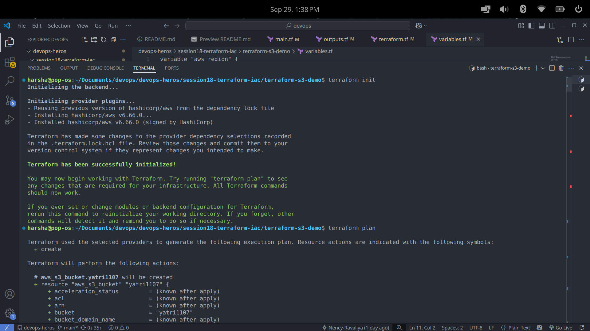
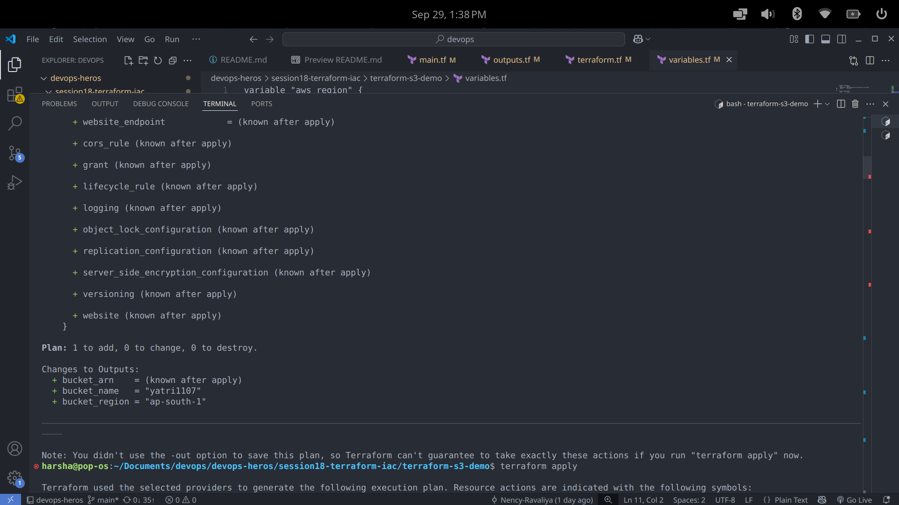
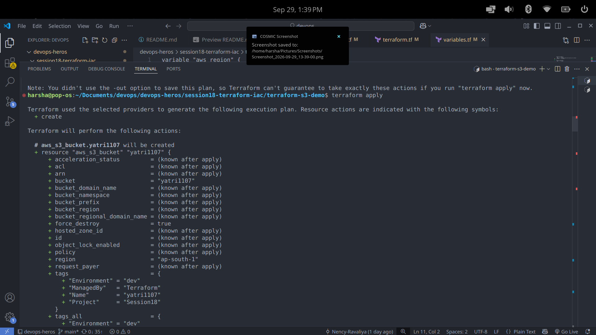
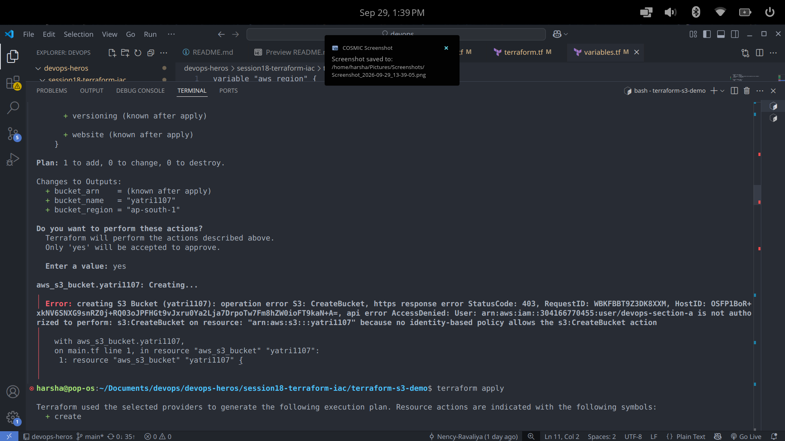
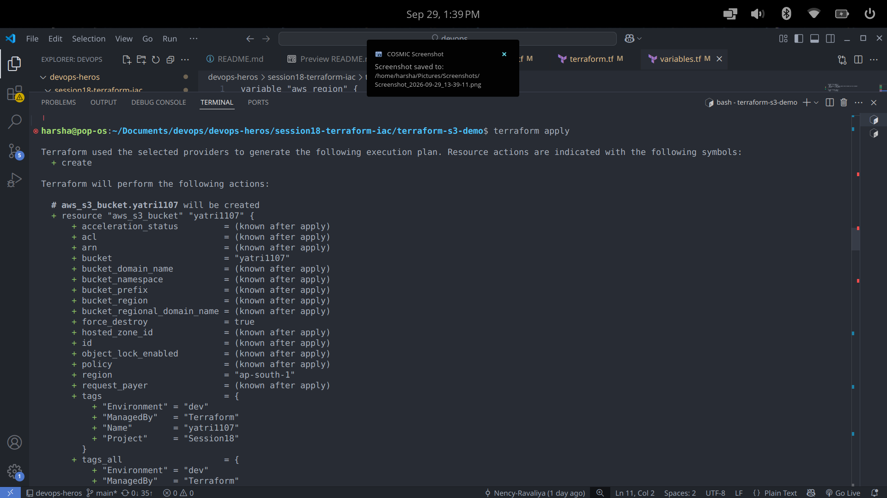
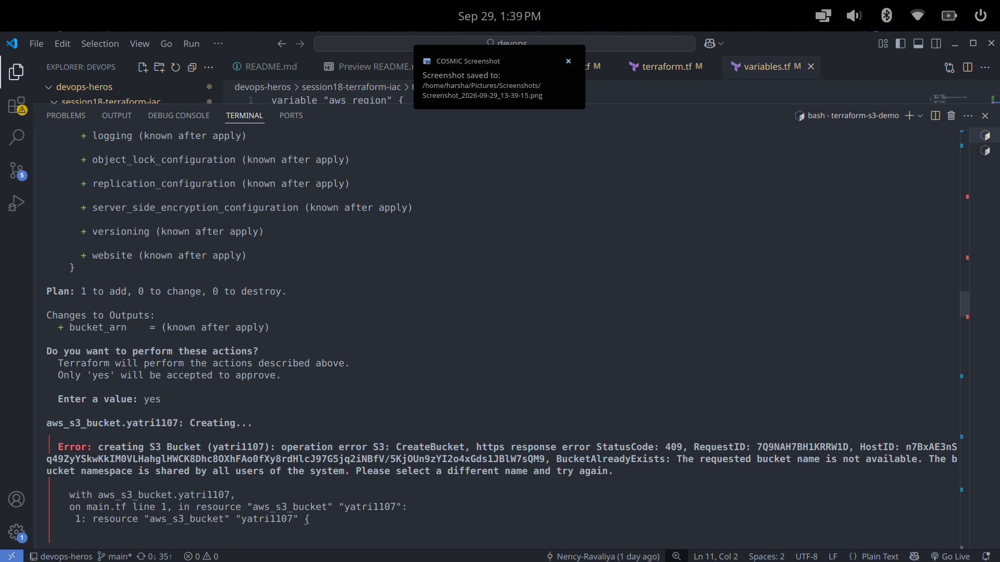
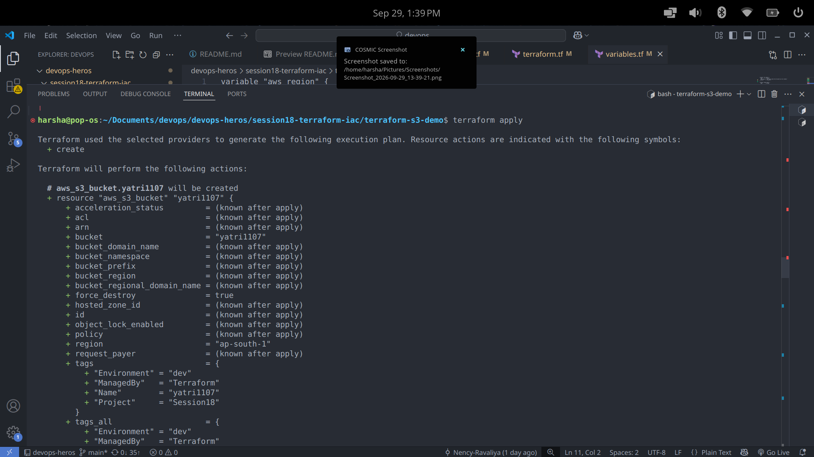
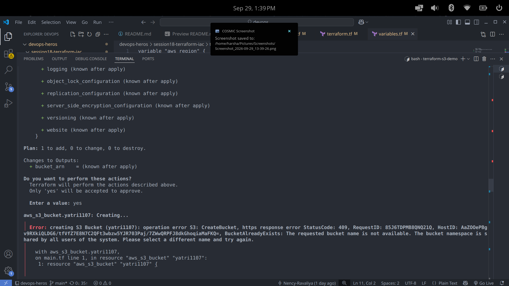
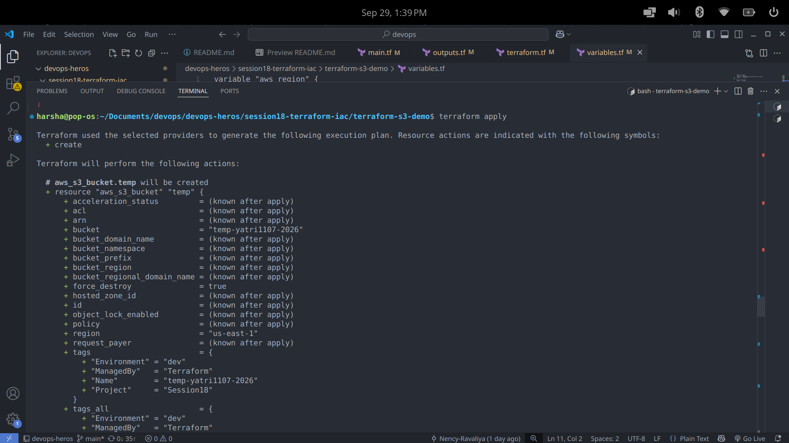
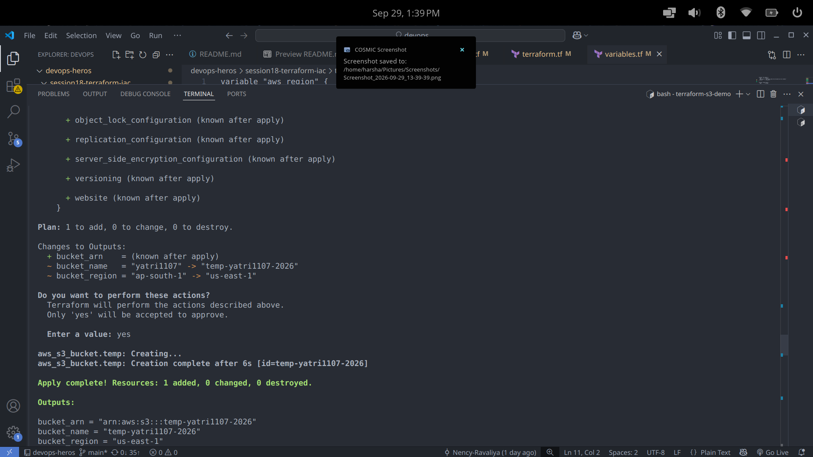
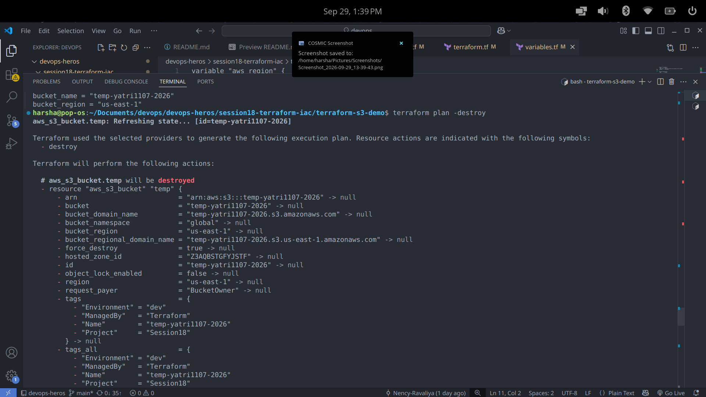
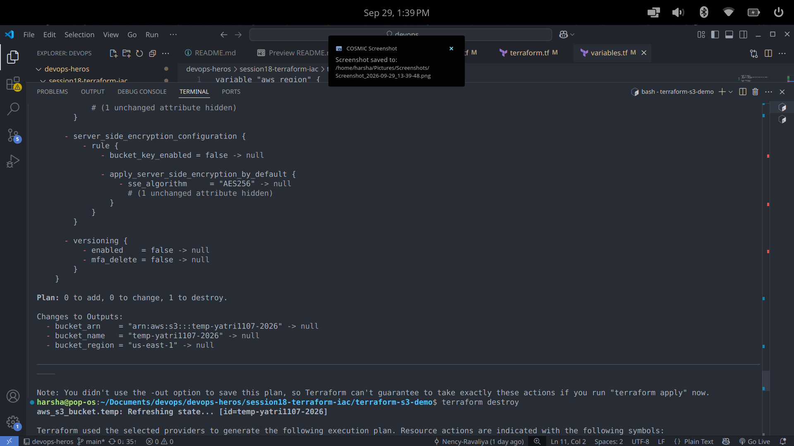
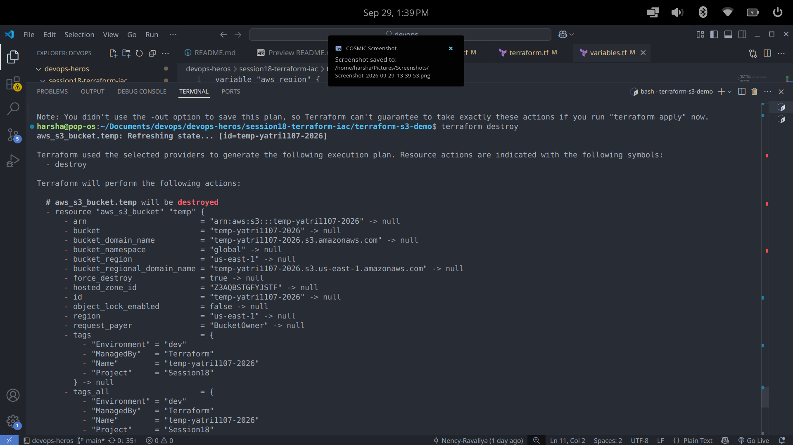
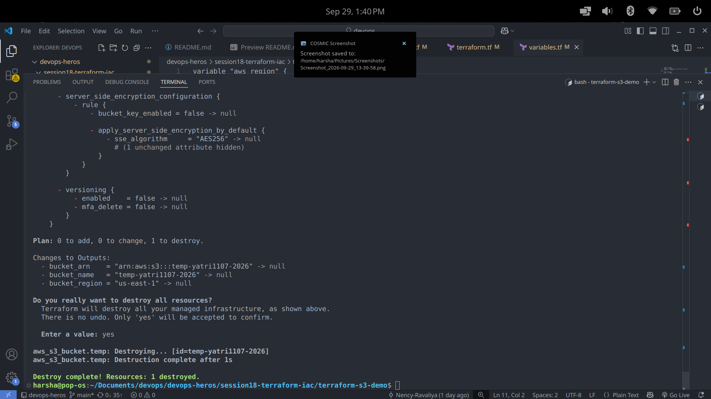

## Task 2 — AWS services research

- [01 — IAM: Governance](aws-services/01-iam/README.md)
- [02 — EC2: Compute](aws-services/02-ec2/README.md)
- [03 — S3: Storage](aws-services/03-s3/README.md)
- [04 — VPC: Networking](aws-services/04-vpc/README.md)
- [05 — DynamoDB & RDS: Database Services](aws-services/05-dynamodb-rds/README.md)

## References

- [Terraform AWS provider documentation](https://registry.terraform.io/providers/hashicorp/aws/latest/docs)
- [AWS documentation](https://docs.aws.amazon.com/)
- [Terraform CLI documentation](https://developer.hashicorp.com/terraform/cli)
