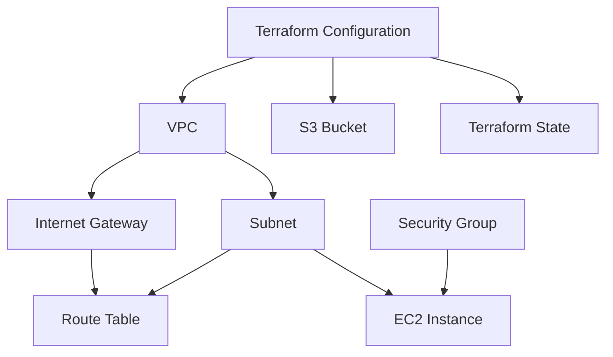

# Session 19: Cloud & Terraform in Action

## 1. Objective

Build and manage AWS infrastructure using Terraform (Infrastructure as Code). This project demonstrates Terraform providers, variables, resources, outputs, dependencies, AWS infrastructure, state management, and the complete `plan`, `apply`, and `destroy` workflow.

## 2. Suggested Architecture

The project provisions a VPC with a subnet, security group, and EC2 instance, plus an S3 bucket.



The exact routing and reachability depend on the Terraform configuration. For an EC2 instance to be reachable from the internet, it generally needs a public IP, a route through an Internet Gateway, and narrowly scoped security-group rules. Do not expose SSH or application ports to the entire internet unless there is a deliberate reason.

## 3. Infrastructure Components

| Component | Purpose |
|---|---|
| Terraform provider | Configures the AWS provider and the region in which resources are created. |
| Variables | Makes values such as region, CIDR blocks, instance type, and resource names configurable. |
| VPC | Provides an isolated virtual network in AWS. |
| Subnet | Places resources inside a selected address range within the VPC. |
| Internet Gateway | Enables internet routing for subnets whose route tables direct traffic through it. |
| Route table | Defines where subnet traffic is routed. |
| Security Group | Acts as a stateful virtual firewall for supported resources such as EC2. |
| EC2 instance | Provides virtual compute capacity to run a workload. |
| S3 bucket | Provides object storage for files and data. |
| Outputs | Displays useful values such as resource IDs, VPC ID, subnet ID, EC2 public IP (if assigned), and S3 bucket name. |
| Terraform state | Tracks the relationship between Terraform configuration and managed infrastructure. |

## 4. Terraform Project Structure

A typical project can be organized as follows:

```text
cloud-terraform/
├── provider.tf
├── versions.tf
├── variables.tf
├── terraform.tfvars
├── main.tf
├── outputs.tf
├── README.md
└── .gitignore
```

- `versions.tf`: declares the required Terraform and provider versions.
- `provider.tf`: configures the AWS provider and region.
- `variables.tf`: declares configurable inputs and validation rules.
- `terraform.tfvars`: supplies local input values; do not put credentials or secrets here.
- `main.tf`: defines the VPC, subnet, routing, security group, EC2 instance, and S3 bucket.
- `outputs.tf`: exposes selected values after apply.

For larger projects, split network, compute, and storage resources into separate `.tf` files or reusable modules.

## 5. Prerequisites

Install Terraform and the AWS CLI, and configure AWS credentials using an approved method such as an AWS CLI profile or environment-based credentials. Avoid storing access keys directly in Terraform files.

Verify the tools and identity:

```bash
terraform version
aws --version
aws sts get-caller-identity
```

The last command confirms which AWS identity the CLI will use. Ensure it is the intended account before creating resources.

## 6. Terraform Workflow

Run commands from the directory containing the Terraform files.

### Step 1: Initialize

```bash
terraform init
```

Initializes the working directory, downloads required providers, and prepares the backend.

### Step 2: Format

```bash
terraform fmt -recursive
```

Formats Terraform configuration files consistently.

### Step 3: Validate

```bash
terraform validate
```

Checks that the configuration is syntactically valid and internally consistent. It does not prove that AWS will authorize or successfully create every resource.

### Step 4: Review the plan

```bash
terraform plan
```

Shows the proposed additions, changes, and deletions without applying them. Review the plan before continuing, particularly any public network rules, EC2 settings, and S3 access settings.

To save a reviewable plan:

```bash
terraform plan -out=tfplan
terraform show tfplan
```

A saved plan can contain sensitive values. Do not commit it to source control.

### Step 5: Apply

```bash
terraform apply
```

Review the proposed actions and confirm when prompted. Alternatively, apply a previously reviewed saved plan:

```bash
terraform apply tfplan
```

After successful creation, Terraform records resource information in its state.

### Step 6: Inspect resources and outputs

```bash
terraform show
terraform output
terraform output vpc_id
terraform output subnet_id
terraform output ec2_public_ip
terraform output s3_bucket_name
```

The named output commands work only if those output names are defined in `outputs.tf`. Use `terraform output` to see which outputs the actual configuration provides.

You can also inspect resources with the AWS CLI, for example:

```bash
aws ec2 describe-vpcs
aws ec2 describe-instances
aws s3api list-buckets
```

These commands show account resources, not only those managed by the current Terraform project. Filter results using the tags or IDs from your Terraform outputs.

### Step 7: Destroy when finished

```bash
terraform plan -destroy
terraform destroy
```

Review the destruction plan and confirm before Terraform removes the resources it manages. Make sure any data you need has been backed up first.

An S3 bucket containing objects may not be removable by a normal destroy operation unless its objects are empty or the configuration explicitly manages their deletion. Do not enable automatic object deletion in production without considering data-retention requirements.

## 7. Terraform Providers, Variables, Resources, and Outputs

### Provider

The AWS provider translates Terraform configuration into AWS API operations. Provider configuration typically selects the AWS region, while authentication is obtained from the configured AWS credential chain.

### Variables

Variables make a configuration reusable across environments. Common examples include:

- AWS region
- VPC CIDR block
- Subnet CIDR block
- EC2 instance type
- Project name and resource tags

Use defaults only for non-sensitive configuration. Keep credentials out of variable files.

### Resources

Resources describe the infrastructure Terraform should manage. Examples in this project include an AWS VPC, subnet, route table, Internet Gateway, security group, EC2 instance, and S3 bucket.

### Outputs

Outputs present selected values after provisioning, allowing operators to inspect resource IDs and connect to resources when appropriate. Avoid outputting credentials, private keys, or other sensitive values.

## 8. Dependencies

Terraform builds a dependency graph from resource references. For example:

- A subnet references its VPC ID, so Terraform knows to create the VPC first.
- A route table association references both a route table and a subnet.
- An EC2 network interface or instance references its subnet and security group.
- Outputs reference resource attributes that become available after creation.

Prefer expression references over unnecessary `depends_on` declarations because references communicate the actual dependency directly. Use explicit `depends_on` only when a real dependency cannot be expressed through an argument reference.

## 9. Terraform State

Terraform state maps the resources in the configuration to real infrastructure objects. It helps Terraform calculate what needs to be created, updated, or removed.

Useful commands:

```bash
terraform state list
terraform state show aws_vpc.main
terraform show
```

The resource address passed to `terraform state show` must match the address in your configuration.

### State safety

- Do not commit `terraform.tfstate`, backup state files, saved plan files, or credential files.
- Restrict access to state because it can contain sensitive information.
- For team use, prefer a remote backend with encryption, access controls, and state locking appropriate to the backend.
- Do not manually edit state files unless following a carefully understood recovery procedure.
- Avoid running concurrent applies against the same state without supported locking.

## 10. Security and Cost Considerations

- Use the least-privilege AWS identity that can complete the assignment.
- Set a region explicitly and confirm the AWS account before applying.
- Restrict security-group ingress to the source IPs and ports actually needed.
- Avoid public S3 access. Enable S3 Block Public Access and encryption in the bucket configuration.
- Use tags to identify resources and simplify cleanup.
- EC2 instances, NAT Gateways, public IPv4 addresses, data transfer, and other AWS services may incur charges. Charges depend on the resources and region.
- Destroy the demo infrastructure after testing, then verify in the AWS console or CLI that any billable resources you created have been removed.
- Keep an eye on resources that may exist outside Terraform state; `terraform destroy` only manages the objects represented by the current state.

## 11. Expected Result

After a successful `terraform apply`, AWS should contain the resources defined by the configuration. `terraform show` should display the managed infrastructure, and `terraform output` should return the configured outputs.

After `terraform destroy` completes, Terraform-managed resources should be removed, subject to resource-specific constraints such as non-empty S3 buckets or resources that have been changed outside Terraform.

## 12. Conclusion

This project demonstrates Infrastructure as Code by describing AWS infrastructure in Terraform, reviewing planned changes, provisioning resources, inspecting state and outputs, and safely destroying the demo environment. Terraform makes infrastructure changes repeatable, reviewable, and easier to version-control.

## 13. References

- [Terraform documentation](https://developer.hashicorp.com/terraform/docs)
- [Terraform CLI commands](https://developer.hashicorp.com/terraform/cli/commands)
- [AWS provider documentation](https://registry.terraform.io/providers/hashicorp/aws/latest/docs)
- [Amazon VPC documentation](https://docs.aws.amazon.com/vpc/latest/userguide/what-is-amazon-vpc.html)
- [Amazon EC2 documentation](https://docs.aws.amazon.com/ec2/)
- [Amazon S3 documentation](https://docs.aws.amazon.com/s3/)
