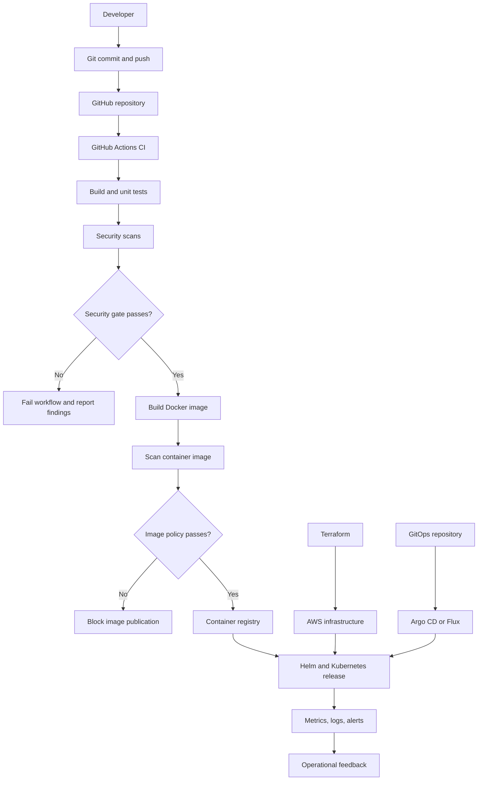

# Session 21: Final DevOps Project & Troubleshooting

## 1. Project Overview

This project brings together the DevOps practices covered throughout the course into one end-to-end workflow. It packages an application, validates changes automatically, scans for security issues, builds and publishes a Docker image, deploys the application to Kubernetes through Helm, monitors application health, and uses GitOps principles to manage the desired cluster state.

Terraform is used to provision the cloud infrastructure. Git is the source-control system, and GitHub hosts the code and CI/CD workflows.

> **Implementation note:** Adapt resource names, ports, cloud region, image registry, and Kubernetes context to your own repository and AWS account. Do not commit credentials, Terraform state, or generated secret values.

## 2. Architecture Diagram



### Main flow

1. A developer changes the application and pushes the code to GitHub.
2. GitHub Actions checks out the code and runs build and unit-test steps.
3. Static analysis, dependency analysis, secret detection, and container-image scanning run as configured.
4. Security gates stop publication when configured policies fail.
5. A Docker image is built, tagged, and pushed to the configured registry.
6. Terraform provisions infrastructure and Kubernetes runs the workload.
7. Helm packages and deploys the application configuration.
8. A GitOps controller reconciles Kubernetes resources against the desired state stored in Git.
9. Monitoring and logs help confirm application health and investigate failures.

CI/CD deployment and GitOps should have a clearly defined ownership model. Avoid configuring both a pipeline and a GitOps controller to continuously overwrite the same Kubernetes resources independently.

## 3. Technologies Used

| Area | Technology | Purpose |
|---|---|---|
| Source control | Git, GitHub | Version control, reviews, and collaboration |
| Application | Application runtime and test framework | Business logic and automated tests |
| Containerization | Docker | Package the application into an image |
| CI/CD | GitHub Actions | Automate build, testing, scanning, publishing, and optional deployment |
| SAST | Bandit, Semgrep, or CodeQL | Detect selected source-code security issues |
| SCA | pip-audit, Dependabot, or equivalent | Identify vulnerable dependencies |
| Secret scanning | Gitleaks or GitHub secret scanning | Detect credentials accidentally committed to source |
| Image scanning | Trivy | Scan image packages and configuration for known vulnerabilities |
| Registry | GitHub Container Registry (GHCR) or another approved registry | Store versioned container images |
| Infrastructure as Code | Terraform and AWS provider | Provision and manage cloud infrastructure |
| Orchestration | Kubernetes, Minikube or a managed cluster | Schedule and operate application containers |
| Packaging | Helm | Template, install, upgrade, and roll back Kubernetes resources |
| Monitoring | Prometheus and Grafana | Collect and visualize metrics; create alert rules |
| Logs | `kubectl logs` and a log aggregation tool | Investigate application behavior |
| GitOps | Argo CD or Flux | Reconcile the cluster against Git-defined desired state |

Use only the tools actually configured in the project. Alternative tools may be substituted when they provide the required capability.

## 4. Repository Structure

A recommended repository layout is:

```text
final-devops-project/
├── application/
│   ├── src/
│   └── tests/
├── docker/
│   └── Dockerfile
├── kubernetes/
│   ├── namespace.yaml
│   ├── configmap.yaml
│   ├── secret.example.yaml
│   ├── deployment.yaml
│   ├── service.yaml
│   ├── ingress.yaml
│   ├── hpa.yaml
│   └── pvc.yaml
├── helm/
│   └── application-chart/
│       ├── Chart.yaml
│       ├── values.yaml
│       └── templates/
├── terraform/
│   ├── versions.tf
│   ├── provider.tf
│   ├── variables.tf
│   ├── main.tf
│   ├── outputs.tf
│   └── README.md
├── .github/
│   └── workflows/
│       ├── ci.yml
│       └── release.yml
├── security/
│   ├── trivy.yaml
│   └── README.md
├── monitoring/
│   ├── README.md
│   └── alerts/
├── gitops/
│   ├── README.md
│   └── applications/
└── README.md
```

The exact structure can vary. Keep manifests, Helm templates, Terraform configuration, workflow files, and security policy in clear locations.

## 5. Application Setup

The application should include source code and automated unit tests.

### Local validation

Run the commands appropriate to the chosen language and package manager. For a Python application, an example is:

```bash
python3 -m venv .venv
source .venv/bin/activate
pip install -r application/requirements.txt
pytest -q application/tests
```

A successful test run means the tests included in the project passed; it does not guarantee that every possible defect has been found.

### Configuration

- Keep environment-specific configuration outside application source code.
- Store non-sensitive settings in a ConfigMap or deployment configuration.
- Provide sensitive values through Kubernetes Secrets or an external secret manager.
- Do not commit real passwords, tokens, cloud access keys, or private certificates.
- Validate required configuration at application startup and return useful errors when values are missing.

## 6. Docker Setup

The Dockerfile describes how the application is packaged into an image.

Typical responsibilities include:

- Choosing a maintained base image.
- Installing only required dependencies.
- Copying the application and necessary runtime files.
- Running the application as a non-root user where practical.
- Defining the application startup command and listening port.
- Excluding credentials, local virtual environments, test caches, and unrelated files through `.dockerignore`.

### Build and test locally

Example commands (adjust paths and port for the actual Dockerfile):

```bash
docker build -f docker/Dockerfile -t final-devops-app:local .
docker image inspect final-devops-app:local
docker run --rm -p 8080:8080 final-devops-app:local
```

In another terminal, test the configured health endpoint, for example:

```bash
curl -i http://127.0.0.1:8080/health
```

Use the application's real port and health path. A successful local container test should be recorded before deployment.

## 7. Terraform Infrastructure

Terraform manages cloud infrastructure as declarative configuration. The infrastructure layer may include:

- AWS provider and region configuration.
- A VPC and subnet.
- Route tables and an Internet Gateway where public access is required.
- Security groups with narrowly scoped ingress and egress rules.
- A managed Kubernetes cluster or another selected deployment target.
- An S3 bucket for object storage or other project needs.
- Outputs for important resource identifiers.

The exact resources depend on the chosen hosting design. If using Amazon EKS, ensure that the cluster, worker capacity, network configuration, IAM roles, and access configuration are all included in the design.

### Terraform workflow

Run the commands from the Terraform project directory:

```bash
terraform init
terraform fmt -recursive
terraform validate
terraform plan
terraform apply
terraform output
terraform destroy
```

Review the plan before applying changes and review the destruction plan before destroying infrastructure. Some AWS resources may incur charges even when the application is not receiving traffic.

### Terraform state safety

- Keep state files, backups, and saved plan files out of Git.
- Use a remote backend with suitable access controls, encryption, and locking for team or production usage.
- Do not store AWS credentials in Terraform configuration or `.tfvars` files.
- Use least-privilege IAM permissions.
- Confirm the selected AWS account and region before applying or destroying resources.

## 8. Kubernetes Deployment

The application can run on Minikube for development or a suitably configured cloud Kubernetes cluster for deployment.

### Required Kubernetes objects

| Object | Responsibility |
|---|---|
| Deployment | Manages application replicas and rollout updates |
| Service | Provides a stable network endpoint for Pods |
| ConfigMap | Supplies non-sensitive configuration |
| Secret | Supplies sensitive values to authorized workloads |
| Ingress | Defines HTTP/HTTPS routing rules |
| Ingress Controller | Implements Ingress rules and handles incoming traffic |
| HPA | Scales replicas based on configured metrics and resource requests |
| Probes | Detect application startup, readiness, and liveness |
| PersistentVolumeClaim (optional) | Requests storage for workloads that require persistent data |

### Example deployment workflow

```bash
kubectl apply -f kubernetes/namespace.yaml
kubectl apply -f kubernetes/configmap.yaml
kubectl apply -f kubernetes/deployment.yaml
kubectl apply -f kubernetes/service.yaml
kubectl rollout status deployment/APP_DEPLOYMENT_NAME
kubectl get pods,services -o wide
```

Replace `APP_DEPLOYMENT_NAME` with the name defined in the Deployment manifest. Apply Secrets, Ingress, HPA, and storage manifests when configured and required by the project.

### Health probes

- **Readiness probe:** determines whether the container should receive Service traffic.
- **Liveness probe:** detects a container that should be restarted after repeated failures.
- **Startup probe:** gives a slow-starting application time to initialize before liveness checks begin.

Probe endpoints should reflect application health and avoid causing unnecessary restarts under normal startup or load.

### HPA

The Horizontal Pod Autoscaler needs a supported metrics source. For a local Minikube demonstration, the Metrics Server add-on can provide basic resource metrics:

```bash
minikube addons enable metrics-server
kubectl get hpa
kubectl top pods
kubectl describe hpa APP_HPA_NAME
```

A Pod's CPU utilization target is evaluated relative to CPU requests configured on the relevant container. Actual scaling behavior depends on current metrics, stabilization rules, and cluster capacity.

## 9. Helm Deployment

Helm packages Kubernetes resources into a reusable chart. Chart values let the same chart be configured for development, test, and production environments.

A chart typically contains:

- `Chart.yaml`: chart metadata.
- `values.yaml`: default configuration.
- `templates/`: parameterized Kubernetes manifests.

### Validate and deploy

```bash
helm lint helm/application-chart
helm template final-app helm/application-chart
helm upgrade --install final-app helm/application-chart -f helm/application-chart/values.yaml
helm status final-app
helm list
```

### Upgrade and rollback

```bash
helm upgrade final-app helm/application-chart -f helm/application-chart/values.yaml
helm history final-app
helm rollback final-app REVISION_NUMBER
```

Replace `REVISION_NUMBER` with a revision displayed by `helm history`. Verify the resulting rollout and application health after every upgrade or rollback.

For a GitOps-managed application, choose whether Helm releases are reconciled by the GitOps controller or installed manually. Avoid having independent automation systems fight over the same resources.

## 10. CI/CD Pipeline

GitHub Actions workflows are stored in `.github/workflows/`. A complete workflow may have separate validation and release jobs.

### CI stages

1. Check out the repository.
2. Configure the required language/runtime.
3. Install dependencies.
4. Run formatting or linting checks.
5. Build the application.
6. Run unit and integration tests.
7. Upload useful test reports when supported.

### DevSecOps stages

1. **SAST:** analyze source code for selected security weaknesses.
2. **SCA:** inspect direct and transitive dependencies for known vulnerabilities.
3. **Secret scanning:** identify accidental credentials or tokens in source and commit history.
4. **Docker build:** package the application into an image after required checks pass.
5. **Container image scan:** scan operating-system packages, application dependencies, and image configuration as supported by the scanning tool.
6. **Security gate:** fail the pipeline when the configured policy is violated.
7. **Publish image:** authenticate to the registry using a scoped token, then push an immutable or versioned image tag.
8. **Deploy:** update Kubernetes through the selected release mechanism.

### Example flow

```text
Commit / Pull Request
        |
        v
 Checkout + Build
        |
        v
     Unit Tests
        |
        v
   SAST / SCA / Secret Scan
        |
        v
    Security Gate
        |
        v
    Docker Build
        |
        v
  Container Image Scan
        |
        v
    Security Gate
        |
        v
  Push Image to Registry
        |
        v
  Helm / GitOps Deployment
        |
        v
    Health Verification
```

### Workflow security

- Use GitHub Actions secrets or an identity-federation mechanism for credentials.
- Prefer short-lived credentials such as OIDC federation when supported by the cloud target.
- Grant each workflow job only the permissions it needs.
- Pin third-party Actions to reviewed versions or commit SHAs according to your organization’s policy.
- Publish only from trusted branches or approved release events.
- Prevent pull-request workflows from exposing registry or production credentials to untrusted code.
- Define a policy for scan severities and documented exceptions rather than ignoring all findings.
- Treat scan reports as evidence; a green workflow means only that the configured checks passed.

## 11. DevSecOps Security Gates

Security gates turn scan results into explicit release criteria.

Example gate policy:

| Check | Example policy |
|---|---|
| Unit tests | Required tests must pass |
| SAST | Block on selected high-confidence critical findings |
| SCA | Block on prohibited dependency vulnerabilities according to project policy |
| Secret scanning | Block if a new credential is detected; rotate any exposed credential |
| Image scan | Block image publication for disallowed critical/high vulnerabilities according to policy |
| Image provenance | Publish only from an approved source revision and workflow |
| Deployment | Deploy only an image that passed required checks |

Severity and exception rules should be set to suit the project and scanner capabilities. False positives should be reviewed, documented, and time-limited rather than silently suppressed.

## 12. Container Registry

A container registry stores versioned images that Kubernetes can pull.

Common options include GitHub Container Registry (GHCR), Amazon Elastic Container Registry (ECR), and Docker Hub.

A good tagging strategy includes an immutable version such as a commit SHA or release version. Avoid using only `latest` for reproducible production deployments.

The registry should enforce appropriate access controls, and workloads must have the right image-pull permissions when images are private.

## 13. Monitoring, Logs, and Metrics

Monitoring determines whether the deployed application is operating within expected limits. Observability data helps explain the cause when it is not.

### Metrics

Examples:

- CPU and memory usage.
- Pod restarts and unavailable replicas.
- Request rate, latency, and application error rate.
- HPA current and desired replicas.
- Disk and network utilization where relevant.

### Logs

Use Kubernetes logs to inspect application output and failures:

```bash
kubectl logs deployment/APP_DEPLOYMENT_NAME
kubectl get events --sort-by=.lastTimestamp
kubectl describe pod POD_NAME
```

Replace placeholder names with actual resource names.

### Monitoring stack

Prometheus can collect metrics, Grafana can visualize dashboards, and Alertmanager can route alerts from configured rules. Log aggregation and distributed tracing can be added for deeper application diagnosis.

Monitoring should include actionable alerts, an owner for each alert, and a documented response procedure. Avoid alerts that lack a clear operational action.

## 14. GitOps Workflow

GitOps uses Git as the source of truth for the desired Kubernetes configuration. A controller such as Argo CD or Flux continually compares that desired state with the live cluster and reconciles differences according to its policy.

### Recommended process

1. Keep Kubernetes manifests, Helm values, or Kustomize configuration in a version-controlled repository.
2. Submit configuration changes through pull requests.
3. Review required CI, policy, and security checks before merging.
4. Let the GitOps controller detect the approved commit.
5. Reconcile the cluster to the declared state.
6. Verify application health and synchronization status.
7. Roll back by reverting or correcting the Git configuration and allowing reconciliation.

### Ownership model

A clean division of responsibility is important:

- CI validates source code, runs tests/scans, and builds/publishes the image.
- GitOps watches the approved deployment repository or directory and reconciles the cluster.
- Helm defines the application resources and configuration consumed by the selected deployment process.

The CI workflow can update an image tag in the GitOps repository after a successful build. The controller then deploys that declared version. This avoids giving a general CI job unrestricted access to the production cluster.

## 15. Final Troubleshooting Challenge

Intentionally introduce one issue at a time in a non-production environment. For each issue, document the symptom, investigation, root cause, fix, and verification.

### Case 1: CrashLoopBackOff

**Possible symptom:** A Pod repeatedly restarts.

**Investigate:**

```bash
kubectl get pods -o wide
kubectl describe pod POD_NAME
kubectl logs POD_NAME
kubectl logs POD_NAME --previous
```

**Possible root causes:** application exits on startup, invalid configuration, missing dependency, or an incorrect command.

**Fix and verify:** correct the application configuration or startup command, apply the change, and verify the Pod becomes Ready without repeated restarts.

### Case 2: ImagePullBackOff

**Possible symptom:** Kubernetes cannot pull the application image.

**Investigate:**

```bash
kubectl describe pod POD_NAME
kubectl get events --sort-by=.lastTimestamp
```

**Possible root causes:** wrong image name or tag, private registry credentials, or registry/network availability.

**Fix and verify:** correct the image reference or authorized image-pull credentials. Wait for the replacement Pod and confirm the image starts successfully.

### Case 3: Service has no endpoints

**Possible symptom:** The Service exists but application requests fail.

**Investigate:**

```bash
kubectl get services
kubectl get pods --show-labels
kubectl get endpoints SERVICE_NAME
kubectl describe service SERVICE_NAME
```

**Possible root cause:** Service selector labels do not match the Pod labels, or no Pods are Ready.

**Fix and verify:** correct the selector or readiness issue. Confirm endpoints appear and the application responds through the Service.

### Case 4: Ingress does not route traffic

**Possible symptom:** Requests return a default response, 404, or connection error.

**Investigate:** Verify the Ingress object, host/path, backend Service, endpoints, Ingress class, controller health, DNS, and relevant controller logs.

```bash
kubectl get ingress
kubectl describe ingress INGRESS_NAME
kubectl get services,endpoints
kubectl get pods -A
```

**Possible root causes:** incorrect host/path, missing controller, incorrect backend Service/port, or DNS pointing to the wrong address.

**Fix and verify:** correct the routing rule or controller setup, then test using the expected hostname and path.

### Case 5: HPA does not scale

**Possible symptom:** The replica count stays unchanged under load.

**Investigate:**

```bash
kubectl get hpa
kubectl describe hpa HPA_NAME
kubectl top pods
kubectl get deployment DEPLOYMENT_NAME -o yaml
```

**Possible root causes:** Metrics Server is unavailable, CPU requests are missing, load is insufficient, or the replica limit has been reached.

**Fix and verify:** restore metrics availability, configure appropriate resource requests, generate controlled load, and check current versus desired replicas.

### Case 6: Terraform drift or unexpected changes

**Possible symptom:** Terraform proposes unexpected infrastructure changes.

**Investigate:**

```bash
terraform fmt -check -recursive
terraform validate
terraform plan
terraform state list
```

**Possible root causes:** manual changes in AWS, changed configuration, a different workspace/backend, or stale/misunderstood state.

**Fix and verify:** confirm the intended AWS account, region, workspace, and backend. Reconcile configuration with the desired infrastructure and review the plan before applying. Never delete or manually edit state as a first troubleshooting step.

### Troubleshooting record template

For every issue, record:

1. **Problem:** What failed, and what was the observable symptom?
2. **Investigation:** Which commands, logs, events, or workflow steps were checked?
3. **Root cause:** What evidence identifies the cause?
4. **Fix:** What configuration or code was changed?
5. **Verification:** What command or test proves the issue is resolved?
6. **Prevention:** What test, alert, policy, or review could catch it earlier?

## 16. Screenshots

Add actual screenshots of your own successful execution here. Keep image files in the repository and use paths relative to this README.

Suggested evidence:
- CI workflow with build and unit tests passing.
- Security scans and security-gate results.
- Docker image published to the registry.
- Kubernetes rollout, Service, HPA, and application health verification.
- Helm release status and, where implemented, GitOps synchronization status.
- Terraform plan/apply output with resource identifiers, omitting sensitive data.

Example Markdown after adding an image to `screenshots/`:

```markdown

```

Do not use fabricated terminal or GitHub Actions screenshots. Redact tokens, account-sensitive information, private IPs if required by your submission policy, and any other sensitive details before publishing images.

## 17. Lessons Learned

This project combines source control, automated validation, containerization, security scanning, infrastructure provisioning, Kubernetes operations, Helm releases, monitoring, and GitOps into a single delivery workflow.

Key lessons include:

- Automating build and test steps reduces the risk of releasing unvalidated code.
- Security checks are more useful when their results enforce explicit release gates.
- Immutable image tags and declarative infrastructure improve reproducibility.
- Kubernetes probes, metrics, logs, and events help diagnose application health.
- Terraform state must be protected and changes reviewed before apply or destroy.
- Helm and GitOps need clearly defined ownership to avoid conflicting deployments.
- Troubleshooting should follow evidence from symptom to root cause, followed by verification and prevention.

## 18. References

- [Git documentation](https://git-scm.com/doc)
- [GitHub Actions](https://docs.github.com/en/actions)
- [Docker documentation](https://docs.docker.com/)
- [Terraform documentation](https://developer.hashicorp.com/terraform/docs)
- [Kubernetes documentation](https://kubernetes.io/docs/home/)
- [Helm documentation](https://helm.sh/docs/)
- [Prometheus documentation](https://prometheus.io/docs/)
- [Grafana documentation](https://grafana.com/docs/)
- [Argo CD documentation](https://argo-cd.readthedocs.io/)
- [Flux documentation](https://fluxcd.io/flux/)
